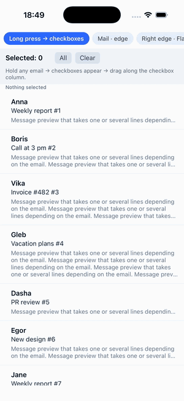
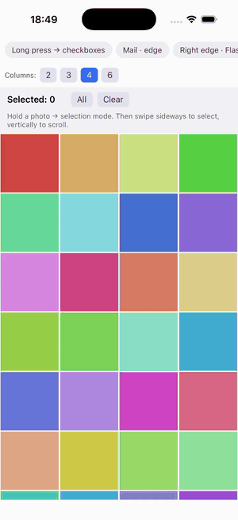
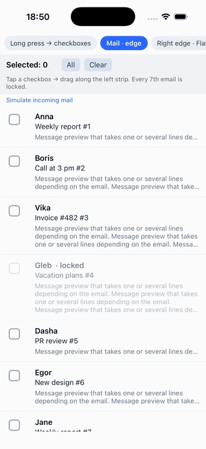

<h1 align="center">Swipe Select</h1>

<p align="center">
  <b>Swipe to multi-select for React Native lists and grids.</b><br>
  Hold, drag your finger, and every item under it gets selected. The list auto-scrolls at the edges.
</p>

<p align="center">
  <a href="https://www.npmjs.com/package/@mironlive/react-native-swipe-select"></a>
  
  
  <a href="./LICENSE"></a>
</p>

<p align="center">
  
  &nbsp;
  
  &nbsp;
  
</p>

- **Any row height.** Real per-item layout and a binary search on the UI thread — no fixed `itemSize`.
- **Your list, your UI.** Works with `FlatList`, `FlashList` v2 and `LegendList`; grids, horizontal and `inverted` lists. Headless: you draw the checkboxes.
- **Three ways to start, combinable:** an edge strip (mail apps), long press (Gmail, Photos), swipe across (iOS Photos select mode).
- **Feels native.** Auto-scroll ramps up towards the edge and runs the same at 60 and 120 Hz. Moving back restores what was there before the gesture.
- **Plays well with your state.** Redux / Zustand / `useState`, one `onSelectionChange` per gesture — not 60 dispatches a second.
- **Expo-ready.** No native code of its own. Tested on iOS and Android, Reanimated 3 and 4, Gesture Handler 2 and 3.

## Installation

```bash
npm i @mironlive/react-native-swipe-select
```

Peer dependencies (you probably have them already):

```bash
npm i react-native-gesture-handler react-native-reanimated
```

**Expo:**

```bash
npx expo install react-native-gesture-handler react-native-reanimated
npm i @mironlive/react-native-swipe-select
```

| Package | Version |
| --- | --- |
| `react-native` | ≥ 0.74 (tested on 0.80, 0.85, 0.88) |
| `react-native-gesture-handler` | ≥ 2.14, including 3.x (tested on 2.27, 2.31, 3.3) |
| `react-native-reanimated` | ≥ 3.6 (tested on 3.18, 4.3, 4.7) |

Wrap your app in `GestureHandlerRootView` and add the Reanimated Babel plugin as their docs describe. In Expo the plugin is already part of `babel-preset-expo`.

## Quick start

```tsx
import { FlatList } from 'react-native';
import { SwipeSelectContainer, useSwipeSelect } from '@mironlive/react-native-swipe-select';

const keyExtractor = (item: Mail) => item.id;

export function Inbox({ mails }: { mails: Mail[] }) {
  const selection = useSwipeSelect({ data: mails, keyExtractor });

  return (
    <SwipeSelectContainer selection={selection}>
      <FlatList
        {...selection.listProps}
        data={mails}
        keyExtractor={keyExtractor}
        extraData={selection.selectedKeys}
        renderItem={({ item }) => (
          <MailRow
            mail={item}
            checked={selection.selectedKeys.has(item.id)}
            onCheckboxPress={() => selection.toggle(item.id)}
          />
        )}
      />
    </SwipeSelectContainer>
  );
}
```

Three rules:

1. Spread `{...selection.listProps}` onto the list — that's how the hook learns row positions and controls scrolling.
2. The list is a **direct child** of `SwipeSelectContainer`.
3. Pass the same `data` and `keyExtractor` as the list.

By default you tap the first checkbox to enter selection mode, then drag along the 56 px strip on the left.

## How the gesture starts — `activation`

```tsx
// Edge strip (default). Like mail apps.
activation: { type: 'edge', side: 'left', size: 56 }

// Long press anywhere on an item. Like Gmail / Photos. No selection mode needed.
activation: { type: 'longPress', minDuration: 300 }

// Swipe across the list. Like iOS Photos: sideways selects, vertical scrolls.
activation: { type: 'pan', activationDistance: 10 }
```

| | `edge` | `longPress` | `pan` |
| --- | --- | --- | --- |
| Where | strip at the edge | the whole item | the whole item |
| Starts | after the finger moves 4 px | after holding | on a swipe across the list |
| Default `when` | `'selectionMode'` | `'always'` | `'selectionMode'` |
| Scrolling | outside the strip | until the hold | along the list |

`when` controls availability: `'always'`, `'selectionMode'` (only while selecting) or `'idle'` (only outside selection mode).

### Combine them

`activation` accepts an array. Like iOS Mail — no checkboxes at first, a long press anywhere enters selection mode, then you drag along the checkbox column:

```tsx
activation: [
  { type: 'longPress', when: 'idle' }, // outside selection mode
  { type: 'edge', side: 'left' },      // inside selection mode
]
```

A photo grid without a "Select" button:

```tsx
activation: [
  { type: 'longPress', when: 'idle' }, // hold a photo — selection mode, keep dragging
  { type: 'pan' },                     // then: sideways selects, vertical scrolls
]
```

Hiding checkboxes outside selection mode is your UI: `showCheckbox={selection.isSelectionMode}`.

**Selection mode** is on while something is selected. If your app has a "Select" button, pass `selectionMode={isSelecting}`.

**Taps** are never intercepted: a tap goes to your own `onPress`, a drag goes to the gesture. No double toggles.

## Your own state (Redux, Zustand…)

```tsx
const selectedIds = useAppSelector((s) => s.mail.selectedIds);
const dispatch = useAppDispatch();

const selection = useSwipeSelect({
  data: mails,
  keyExtractor,
  selectedKeys: selectedIds,
  onSelectionChange: (ids) => dispatch(setSelectedIds(ids)),
});
```

- When `selectedKeys` changes from the outside, the hook picks it up.
- During a gesture the selection lives inside the hook and renders at most once per frame. Your store gets one `onSelectionChange` when the gesture ends.
- `toggle`, `select`, `deselect`, `selectAll`, `clear` also call `onSelectionChange`. The second argument tells you why: `gesture`, `toggle` or `api`.

No external state? Leave `selectedKeys` out; use `defaultSelectedKeys` for the initial selection.

## Lists

### FlatList

A plain `FlatList` from `react-native` works as is.

> ⚠️ **Not Reanimated's `Animated.FlatList`** — it forbids `CellRendererComponent`, which the hook uses to learn row positions. Need an animated list? Use `SwipeSelectFlatList` from this package (it's `Animated.createAnimatedComponent(FlatList)`). In development the hook warns if it receives no geometry.

### FlashList v2

```tsx
import { FlashList } from '@shopify/flash-list';

<FlashList {...selection.listProps} data={data} renderItem={renderItem} />
```

### LegendList

```tsx
import { LegendList } from '@legendapp/list/react-native';

<LegendList {...selection.listProps} data={data} renderItem={renderItem} recycleItems />
```

Nothing else needed: the hook detects LegendList and reads item positions from its state.

### Grids

```tsx
// FlashList: nothing extra
<FlashList {...selection.listProps} numColumns={4} ... />

// FlatList: pass numColumns to the hook too
const selection = useSwipeSelect({ data, keyExtractor, numColumns: 4, activation: { type: 'pan' } });
<FlatList {...selection.listProps} numColumns={4} ... />
```

Grid selection is linear by index, like in Photos: from the first cell to the one under your finger. Change `numColumns` together with the list's `key`.

### Horizontal and inverted

```tsx
useSwipeSelect({ data, keyExtractor, horizontal: true, activation: { type: 'longPress' } });
<FlatList {...selection.listProps} horizontal ... />

useSwipeSelect({ data, keyExtractor, inverted: true, activation: { type: 'longPress' } }); // chats
<FlatList {...selection.listProps} inverted ... />
```

### Custom `CellRendererComponent`

`listProps` includes a `CellRendererComponent`. If you need your own, report geometry yourself:

```tsx
const MyCell = ({ index, onLayout, ...props }) => (
  <View
    {...props}
    onLayout={(e) => {
      onLayout?.(e);
      const { x, y, width, height } = e.nativeEvent.layout;
      selection.onItemLayout({ index, key: data[index].id, x, y, width, height });
    }}
  />
);
```

Coordinates are relative to the list content.

### Your own `ref`, `onLayout`, `onScroll`

```tsx
<FlatList
  {...selection.listProps}
  ref={(list) => { selection.listProps.ref(list); myListRef.current = list; }}
  onLayout={(e) => { selection.listProps.onLayout(e); myOnLayout(e); }}
  onScroll={myOnScroll} // the hook doesn't need onScroll — pass yours as usual
/>
```

## What the selection holds

Keys — strings from your `keyExtractor`. A key can be anything: `id`, `uuid`, `` `${folder}:${id}` ``. Keys survive pagination, sorting and new items; indices don't.

| You need | Use |
| --- | --- |
| keys for rendering | `selection.selectedKeys` — `Set<string>` |
| keys for your store | `onSelectionChange(keys)` — `string[]` |
| the items themselves | `selection.getSelectedItems()` — objects from `data`, in list order |
| indices | `selection.getSelectedIndices()` |
| what's under the finger | `onItemEnter({ key, index, mode, isAutoScrolling })` |

```tsx
const onDelete = () => {
  const mails = selection.getSelectedItems();
  api.delete(mails.map((m) => m.serverId));
  selection.clear();
};
```

## Customization

**Look and feel — all yours.** The package draws nothing. Use the state:

```tsx
selection.isSelectionMode     // show checkboxes, a "Done (N)" bar
selection.isDragging          // a finger is dragging a selection
selection.selectedCount
selection.autoScrollDirection // SharedValue: -1 up, 0, 1 down — for highlighting zones
```

**Auto-scroll speed:**

```tsx
autoScroll: {
  edgeSize: 80,   // edge zone, px (default 60)
  minSpeed: 150,  // at the inner border of the zone, px/s (default 120)
  maxSpeed: 1400, // at the very edge, px/s (default 900)
}
// autoScroll: false — turn it off
```

**Haptics:**

```tsx
import * as Haptics from 'expo-haptics';

useSwipeSelect({
  ...
  onDragStart: () => Haptics.impactAsync(Haptics.ImpactFeedbackStyle.Medium),
  onItemEnter: () => Haptics.selectionAsync(), // on every new item under the finger
});
```

**Limit it:**

```tsx
enabled: !isEditingTitle,                        // turn the gesture off
isItemSelectable: (m) => m.status !== 'sending', // skipped while swiping
selectionMode: isSelecting,                      // mode driven by a button
```

## API

### `useSwipeSelect(options)`

| Option | Type | Default | |
| --- | --- | --- | --- |
| `data` | `T[]` | — | the list's data |
| `keyExtractor` | `(item, index) => string` | — | item key |
| `selectedKeys` | `string[] \| Set<string>` | — | external selection state |
| `defaultSelectedKeys` | `string[]` | `[]` | initial selection without external state |
| `onSelectionChange` | `(keys, reason) => void` | — | once per gesture; `reason`: `gesture` / `toggle` / `api` |
| `isItemSelectable` | `(item, index) => boolean` | all | non-selectable items are skipped |
| `activation` | object or array | `{ type: 'edge' }` | how the gesture starts |
| `selectionMode` | `boolean` | `selectedCount > 0` | selection mode |
| `enabled` | `boolean` | `true` | turn the gesture off |
| `horizontal` | `boolean` | `false` | horizontal list |
| `inverted` | `boolean` | `false` | inverted list |
| `numColumns` | `number` | `1` | columns for FlatList / LegendList; not needed for FlashList |
| `autoScroll` | `boolean \| { edgeSize, minSpeed, maxSpeed }` | `{ 60, 120, 900 }` | px and px/s |
| `onDragStart` | `({ key, index, mode }) => void` | — | |
| `onItemEnter` | `({ key, index, mode, isAutoScrolling }) => void` | — | |
| `onDragEnd` | `({ selectedKeys, mode }) => void` | — | |

Returns:

| | |
| --- | --- |
| `selectedKeys` | `ReadonlySet<string>` — a new object on every change, fine for `extraData` |
| `selectedCount`, `isSelectionMode`, `isDragging` | state for your UI |
| `isSelected(key)`, `toggle(key)` | |
| `select(keys)`, `deselect(keys)`, `setSelection(keys)`, `selectAll()`, `clear()` | |
| `getSelectedItems()`, `getSelectedIndices()` | selected objects / indices |
| `listProps` | props for the list: `ref` (callback), `onLayout`, `onContentSizeChange`, `scrollEnabled`, `scrollEventThrottle`, `CellRendererComponent` |
| `onItemLayout(layout)` | manual geometry registration |
| `autoScrollDirection` | `SharedValue<number>` |
| `gesture` | the gesture itself, if you want your own `GestureDetector` instead of the container |

### Components

- `SwipeSelectContainer` — `GestureDetector` + `View`. Props: `selection`, `style`, `children`.
- `SwipeSelectFlatList` — `Animated.createAnimatedComponent(FlatList)` for when you need an animated FlatList.

## Performance

Your list keeps its own virtualization. The package only reads cell positions and the scroll offset.

| When | What the package does | Cost |
| --- | --- | --- |
| At rest | nothing — the frame callback is off | zero |
| Scrolling | refreshes the geometry window every half screen | rare |
| Gesture, every frame | finds the item under the finger (binary search, UI thread), auto-scroll step | ~10 comparisons per 1,000 rows |
| Finger moves onto a new item | applies the range diff + one React render | ~10×/s while auto-scrolling |
| Gesture ends | one `onSelectionChange` | once |

Only a window of ±3–4 screens of geometry is kept on the UI thread; tested on a 10,000-photo grid.

The main cost during a gesture is re-rendering your rows. Keep it cheap: `memo` rows, pass `checked` (a boolean) instead of the whole Set, keep callbacks stable with `useCallback`.

## How it works

- Each cell reports its frame through `CellRendererComponent` into a registry sorted by index (LegendList: positions come from its state).
- A touch is converted to content coordinates (`+ scrollOffset`) and resolved with a binary search inside a worklet. Variable heights, grids and virtualization gaps are fine; on a separator the nearest item wins.
- Selection is a transition between ranges `[anchor..finger]`: entering the range applies the mode, leaving it restores the snapshot taken when the gesture started. Only the diff is processed.
- The scroll offset is read from the native ScrollView (`useScrollOffset`); auto-scroll uses `scrollTo` on the UI thread.
- If `data` changes mid-gesture (a new email at the top, a deletion), the anchor and range are remapped by key. If the anchor item is removed, the gesture ends.

## Limitations

- Index order must match visual order (regular lists and grids). Masonry layouts aren't supported.
- `SectionList` isn't supported.
- Changing `horizontal`, `inverted` or `numColumns` at runtime requires remounting the list (`key`).

## Comparison

| | this package | `@osamaq/drag-select` |
| --- | --- | --- |
| Variable item sizes | yes (real geometry) | no, fixed `itemSize` |
| FlatList / FlashList v2 / LegendList | yes / yes / yes | yes / yes* / — |
| Grids, horizontal | yes | yes |
| `inverted` (chats) | yes | no |
| Activation | edge strip, long press, pan, combinations | long press + pan |
| Non-selectable items | yes | — |
| Restore on backtrack | to the state at gesture start | — |
| External state, one callback per gesture | yes | — |
| Data changes mid-gesture | remapped by key | — |
| Reanimated | 3 and 4 | ≥ 3.16 |

\* per their README: no dynamic sizes.

## Example app

`example/` is a bare React Native app with eight scenarios: mail with a left strip (FlatList, locked items, simulated incoming mail during a gesture), right strip (FlashList), long press, LegendList, chat (`inverted`), FlashList grid, FlatList grid, horizontal list.

```bash
npm run example:install
npm run example:pods
npm run example:start
npm run example:ios     # or: cd example && npm run android
```

## Development

```bash
npm run type-check
npm test        # pure logic: range transitions and hit testing
npm run build
```

## Author

Made by Mironov · [@Mironlive](https://github.com/Mironlive)

[Документация на русском](./README.ru.md)

## License

MIT
