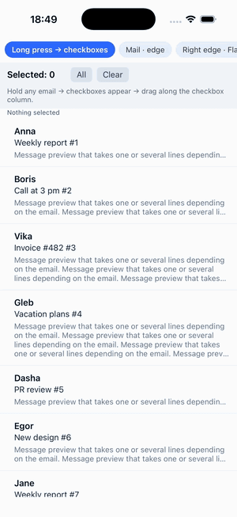
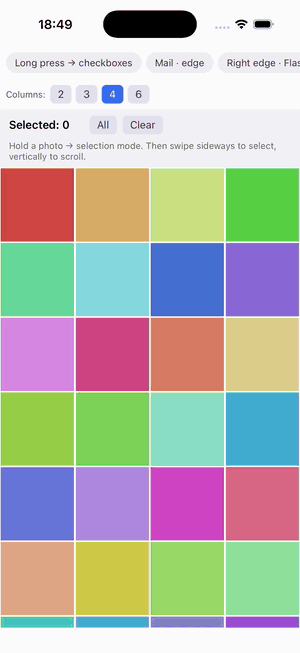
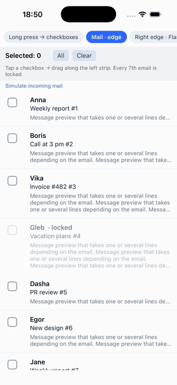

<h1 align="center">Swipe Select</h1>

<p align="center">
  <b>Выбор элементов списка и сетки свайпом для React Native.</b><br>
  Зажал, провёл пальцем — и всё, что под ним, отмечается. У края список сам прокручивается.
</p>

<p align="center">
  <a href="https://www.npmjs.com/package/@mironlive/react-native-swipe-select"></a>
  
  
  
  <a href="https://www.npmjs.com/package/@mironlive/react-native-swipe-select"></a>
  <a href="https://github.com/Mironlive/swipe-select/blob/main/LICENSE"></a>
  
</p>

<p align="center">
  
  &nbsp;
  
  &nbsp;
  
</p>

<p align="center"><a href="https://github.com/Mironlive/swipe-select#readme">English</a> · Русский</p>

- **Любая высота строк.** Реальная геометрия каждой ячейки и бинарный поиск на UI-потоке — никакого фиксированного `itemSize`.
- **Твой список, твой UI.** `FlatList`, `FlashList` v2 и `LegendList`; сетки, горизонтальные и `inverted`-списки. Без UI: чекбоксы рисуешь сам.
- **Три способа начать жест, можно комбинировать:** полоса у края (почтовые клиенты), долгое нажатие (Gmail, «Фото»), свайп поперёк (режим выбора в «Фото» iOS).
- **Ощущается нативно.** Автоскролл ускоряется к краю и одинаков на 60 и 120 Гц. Движение назад возвращает то, что было до жеста.
- **Дружит с твоим стейтом.** Redux / Zustand / `useState`, один `onSelectionChange` на жест — а не 60 диспатчей в секунду.
- **Expo и React Native CLI.** Работает в Expo Go, в Expo dev build и в обычных CLI-проектах — своего нативного кода нет, pods линковать не нужно. Проверено на iOS и Android, Reanimated 3 и 4, Gesture Handler 2 и 3.

## Установка

Ставится одинаково в **Expo** (Expo Go и dev build) и в **React Native CLI** (bare-проекты).

**React Native CLI:**

```bash
npm i @mironlive/react-native-swipe-select
npm i react-native-gesture-handler react-native-reanimated   # если их ещё нет
cd ios && pod install                                        # только если только что добавил gesture-handler / reanimated
```

**Expo:**

```bash
npx expo install react-native-gesture-handler react-native-reanimated
npm i @mironlive/react-native-swipe-select
```

| Пакет | Версия |
| --- | --- |
| `react-native` | ≥ 0.74 (проверено на 0.80, 0.85, 0.88) |
| `react-native-gesture-handler` | ≥ 2.14, включая 3.x (проверено на 2.27, 2.31, 3.3) |
| `react-native-reanimated` | ≥ 3.6 (проверено на 3.18, 4.3, 4.7) |

Оберни приложение в `GestureHandlerRootView` и подключи Babel-плагин Reanimated, как описано в их документации. В Expo плагин уже входит в `babel-preset-expo`.

## Быстрый старт

```tsx
import { FlatList, Pressable, Text, View } from 'react-native';
import { SwipeSelectContainer, useSwipeSelect } from '@mironlive/react-native-swipe-select';

type Mail = { id: string; subject: string };

// Твоя строка — пакет ничего не рисует. Чекбокс держи в левой полосе 56 px.
function MailRow({ mail, checked, onCheckboxPress }: { mail: Mail; checked: boolean; onCheckboxPress: () => void }) {
  return (
    <View style={{ flexDirection: 'row', paddingVertical: 12, backgroundColor: checked ? '#e8f0ff' : '#fff' }}>
      <Pressable onPress={onCheckboxPress} style={{ width: 56, alignItems: 'center' }}>
        <View style={{ width: 22, height: 22, borderRadius: 6, borderWidth: 2, borderColor: '#2f6bff', backgroundColor: checked ? '#2f6bff' : 'transparent' }} />
      </Pressable>
      <Text>{mail.subject}</Text>
    </View>
  );
}

const keyExtractor = (item: Mail) => item.id;

export function Inbox({ mails }: { mails: Mail[] }) {
  const selection = useSwipeSelect({ data: mails, keyExtractor });

  return (
    <SwipeSelectContainer selection={selection}>
      <FlatList
        {...selection.listProps}
        data={mails}
        keyExtractor={keyExtractor}
        extraData={selection.selectedKeys}
        renderItem={({ item }) => (
          <MailRow
            mail={item}
            checked={selection.selectedKeys.has(item.id)}
            onCheckboxPress={() => selection.toggle(item.id)}
          />
        )}
      />
    </SwipeSelectContainer>
  );
}
```

Три правила:

1. `{...selection.listProps}` — в список. Так хук узнаёт позиции строк и управляет скроллом.
2. Список — **прямой потомок** `SwipeSelectContainer`.
3. `data` и `keyExtractor` — те же, что у списка.

По умолчанию первый элемент отмечаешь тапом по чекбоксу, дальше ведёшь пальцем по полосе шириной 56 px слева.

## Как начинается жест — `activation`

```tsx
// Полоса у края (по умолчанию). Как в почтовых клиентах.
activation: { type: 'edge', side: 'left', size: 56 }

// Долгое нажатие в любом месте элемента. Как в Gmail / «Фото». Режим выбора не нужен.
activation: { type: 'longPress', minDuration: 300 }

// Свайп поперёк списка. Как «Фото» iOS: поперёк — выделение, вдоль — скролл.
activation: { type: 'pan', activationDistance: 10 }
```

| | `edge` | `longPress` | `pan` |
| --- | --- | --- | --- |
| Где | полоса у края | весь элемент | весь элемент |
| Старт | после сдвига пальца на 4 px | после удержания | при свайпе поперёк списка |
| `when` по умолчанию | `'selectionMode'` | `'always'` | `'selectionMode'` |
| Скролл | вне полосы | до удержания | вдоль списка |

`when` — когда способ доступен: `'always'`, `'selectionMode'` (только в режиме выбора) или `'idle'` (только вне режима выбора).

### Несколько способов сразу

`activation` принимает массив. Как в iOS Mail — сначала чекбоксов нет, долгое нажатие в любом месте включает режим выбора, дальше ведёшь по колонке чекбоксов:

```tsx
activation: [
  { type: 'longPress', when: 'idle' }, // вне режима выбора
  { type: 'edge', side: 'left' },      // в режиме выбора
]
```

Галерея без кнопки «Выбрать»:

```tsx
activation: [
  { type: 'longPress', when: 'idle' }, // удержал фото — режим выбора, можно сразу вести
  { type: 'pan' },                     // дальше: поперёк — выделение, вдоль — скролл
]
```

Прятать чекбоксы вне режима выбора — это твой UI: `showCheckbox={selection.isSelectionMode}`.

**Режим выбора** включён, пока что-то выбрано. Если у тебя есть кнопка «Выбрать», передай `selectionMode={isSelecting}`.

**Тапы** жест не перехватывает: тап достаётся твоему `onPress`, драг — жесту. Двойного переключения нет.

## Свой стейт (Redux, Zustand…)

```tsx
const selectedIds = useAppSelector((s) => s.mail.selectedIds);
const dispatch = useAppDispatch();

const selection = useSwipeSelect({
  data: mails,
  keyExtractor,
  selectedKeys: selectedIds,
  onSelectionChange: (ids) => dispatch(setSelectedIds(ids)),
});
```

- Если `selectedKeys` меняется снаружи, хук это подхватывает.
- Во время жеста выбор живёт внутри хука и рендерится не чаще раза за кадр. Стор получает один `onSelectionChange`, когда жест заканчивается.
- `toggle`, `select`, `deselect`, `selectAll`, `clear` тоже вызывают `onSelectionChange`. Второй аргумент говорит, откуда изменение: `gesture`, `toggle` или `api`.

Нет внешнего стейта? Не передавай `selectedKeys`; начальный выбор задаётся через `defaultSelectedKeys`.

## Списки

### FlatList

Обычный `FlatList` из `react-native` работает как есть.

> ⚠️ **Не `Animated.FlatList` из Reanimated** — он запрещает `CellRendererComponent`, через который хук узнаёт позиции строк. Нужен анимированный список? Используй `SwipeSelectFlatList` из пакета (это `Animated.createAnimatedComponent(FlatList)`). В dev-режиме хук предупредит, если не получает геометрию.

### FlashList v2

```tsx
import { FlashList } from '@shopify/flash-list';

<FlashList {...selection.listProps} data={data} renderItem={renderItem} />
```

### LegendList

```tsx
import { LegendList } from '@legendapp/list/react-native';

<LegendList {...selection.listProps} data={data} renderItem={renderItem} recycleItems />
```

Больше ничего не нужно: хук сам узнаёт LegendList и берёт позиции элементов из его состояния.

### Сетки

```tsx
// FlashList: ничего дополнительно
<FlashList {...selection.listProps} numColumns={4} ... />

// FlatList: передай numColumns и в хук
const selection = useSwipeSelect({ data, keyExtractor, numColumns: 4, activation: { type: 'pan' } });
<FlatList {...selection.listProps} numColumns={4} ... />
```

Выделение в сетке линейное по индексу, как в «Фото»: от первой ячейки до той, что под пальцем. `numColumns` меняется вместе с `key` у списка.

### Горизонтальные и перевёрнутые

```tsx
useSwipeSelect({ data, keyExtractor, horizontal: true, activation: { type: 'longPress' } });
<FlatList {...selection.listProps} horizontal ... />

useSwipeSelect({ data, keyExtractor, inverted: true, activation: { type: 'longPress' } }); // чаты
<FlatList {...selection.listProps} inverted ... />
```

### Свой `CellRendererComponent`

В `listProps` уже есть `CellRendererComponent`. Если нужен свой — сообщай геометрию сам:

```tsx
const MyCell = ({ index, onLayout, ...props }) => (
  <View
    {...props}
    onLayout={(e) => {
      onLayout?.(e);
      const { x, y, width, height } = e.nativeEvent.layout;
      selection.onItemLayout({ index, key: data[index].id, x, y, width, height });
    }}
  />
);
```

Координаты — относительно контента списка.

### Свои `ref`, `onLayout`, `onScroll`

```tsx
<FlatList
  {...selection.listProps}
  ref={(list) => { selection.listProps.ref(list); myListRef.current = list; }}
  onLayout={(e) => { selection.listProps.onLayout(e); myOnLayout(e); }}
  onScroll={myOnScroll} // хуку onScroll не нужен — передавай свой как обычно
/>
```

## Что хранит выбор

Ключи — строки из твоего `keyExtractor`. Ключом может быть что угодно: `id`, `uuid`, `` `${folder}:${id}` ``. Ключи переживают пагинацию, сортировку и новые элементы, а индексы — нет.

| Нужно | Как получить |
| --- | --- |
| ключи для рендера | `selection.selectedKeys` — `Set<string>` |
| ключи для стора | `onSelectionChange(keys)` — `string[]` |
| сами элементы | `selection.getSelectedItems()` — объекты из `data` в порядке списка |
| индексы | `selection.getSelectedIndices()` |
| что под пальцем | `onItemEnter({ key, index, mode, isAutoScrolling })` |

```tsx
const onDelete = () => {
  const mails = selection.getSelectedItems();
  api.delete(mails.map((m) => m.serverId));
  selection.clear();
};
```

## Кастомизация

**Внешний вид — полностью твой.** Пакет ничего не рисует. Используй состояние:

```tsx
selection.isSelectionMode     // показать чекбоксы, панель «Готово (N)»
selection.isDragging          // палец ведёт выделение
selection.selectedCount
selection.autoScrollDirection // SharedValue: -1 вверх, 0, 1 вниз — для подсветки зон
```

**Скорость автоскролла:**

```tsx
autoScroll: {
  edgeSize: 80,   // зона у края, px (по умолчанию 60)
  minSpeed: 150,  // на внутренней границе зоны, px/с (по умолчанию 120)
  maxSpeed: 1400, // у самого края, px/с (по умолчанию 900)
}
// autoScroll: false — выключить
```

**Хаптика:**

```tsx
import * as Haptics from 'expo-haptics';

useSwipeSelect({
  ...
  onDragStart: () => Haptics.impactAsync(Haptics.ImpactFeedbackStyle.Medium),
  onItemEnter: () => Haptics.selectionAsync(), // на каждом новом элементе под пальцем
});
```

**Ограничения:**

```tsx
enabled: !isEditingTitle,                        // выключить жест
isItemSelectable: (m) => m.status !== 'sending', // пропускаются при свайпе
selectionMode: isSelecting,                      // режим управляется кнопкой
```

## API

### `useSwipeSelect(options)`

| Опция | Тип | По умолчанию | |
| --- | --- | --- | --- |
| `data` | `T[]` | — | данные списка |
| `keyExtractor` | `(item, index) => string` | — | ключ элемента |
| `selectedKeys` | `string[] \| Set<string>` | — | внешний стейт выбора |
| `defaultSelectedKeys` | `string[]` | `[]` | начальный выбор без внешнего стейта |
| `onSelectionChange` | `(keys, reason) => void` | — | раз за жест; `reason`: `gesture` / `toggle` / `api` |
| `isItemSelectable` | `(item, index) => boolean` | все | невыбираемые пропускаются |
| `activation` | объект или массив | `{ type: 'edge' }` | как начинается жест |
| `selectionMode` | `boolean` | `selectedCount > 0` | режим выбора |
| `enabled` | `boolean` | `true` | выключить жест |
| `horizontal` | `boolean` | `false` | горизонтальный список |
| `inverted` | `boolean` | `false` | перевёрнутый список |
| `numColumns` | `number` | `1` | колонки для FlatList / LegendList; для FlashList не нужно |
| `autoScroll` | `boolean \| { edgeSize, minSpeed, maxSpeed }` | `{ 60, 120, 900 }` | px и px/с |
| `onDragStart` | `({ key, index, mode }) => void` | — | |
| `onItemEnter` | `({ key, index, mode, isAutoScrolling }) => void` | — | |
| `onDragEnd` | `({ selectedKeys, mode }) => void` | — | |

Возвращает:

| | |
| --- | --- |
| `selectedKeys` | `ReadonlySet<string>` — новый объект при каждом изменении, годится для `extraData` |
| `selectedCount`, `isSelectionMode`, `isDragging` | состояние для UI |
| `isSelected(key)`, `toggle(key)` | |
| `select(keys)`, `deselect(keys)`, `setSelection(keys)`, `selectAll()`, `clear()` | |
| `getSelectedItems()`, `getSelectedIndices()` | выбранные объекты / индексы |
| `listProps` | пропсы списка: `ref` (callback), `onLayout`, `onContentSizeChange`, `scrollEnabled`, `scrollEventThrottle`, `CellRendererComponent` |
| `onItemLayout(layout)` | ручная регистрация геометрии |
| `autoScrollDirection` | `SharedValue<number>` |
| `gesture` | сам жест — если нужен свой `GestureDetector` вместо контейнера |

### Компоненты

- `SwipeSelectContainer` — `GestureDetector` + `View`. Пропсы: `selection`, `style`, `children`.
- `SwipeSelectFlatList` — `Animated.createAnimatedComponent(FlatList)`, если нужен анимированный FlatList.

## Производительность

Список остаётся твоим — со своей виртуализацией. Пакет только читает позиции ячеек и смещение скролла.

| Когда | Что делает пакет | Цена |
| --- | --- | --- |
| В покое | ничего — колбэк кадра выключен | ноль |
| Скролл | обновляет окно геометрии раз в полэкрана | редко |
| Жест, каждый кадр | ищет элемент под пальцем (бинарный поиск, UI-поток), шаг автоскролла | ~10 сравнений на 1 000 строк |
| Палец перешёл на новый элемент | применяет разницу диапазонов + один React-рендер | ~10 раз/с при автоскролле |
| Конец жеста | один `onSelectionChange` | один раз |

На UI-потоке держится только окно геометрии ±3–4 экрана; проверено на сетке из 10 000 фото.

Основная цена во время жеста — перерисовка твоих строк. Держи её дешёвой: строки в `memo`, передавай в строку `checked` (boolean), а не весь Set, колбэки стабильные через `useCallback`.

## Как это работает

- Каждая ячейка сообщает свою рамку через `CellRendererComponent` в реестр, отсортированный по индексу (у LegendList позиции берутся из его состояния).
- Касание переводится в координаты контента (`+ scrollOffset`) и ищется бинарным поиском прямо в worklet. Разная высота, сетки и дыры виртуализации — не проблема; на разделителе берётся ближайший элемент.
- Выбор — это переход между диапазонами `[якорь..палец]`: вошёл в диапазон — применяется режим, вышел — восстанавливается снимок на момент старта жеста. Обрабатывается только разница.
- Смещение скролла читается с нативного ScrollView (`useScrollOffset`); автоскролл — `scrollTo` на UI-потоке.
- Если `data` меняется посреди жеста (новое письмо сверху, удаление), якорь и диапазон переносятся по ключам. Если удалён элемент, с которого начался жест, жест завершается.

## Ограничения

- Порядок индексов должен совпадать с визуальным (обычные списки и сетки). Masonry-раскладки не поддерживаются.
- `SectionList` не поддерживается.
- `horizontal`, `inverted` и `numColumns` меняются на лету только вместе с перемонтированием списка (`key`).

## Сравнение

| | этот пакет | `@osamaq/drag-select` |
| --- | --- | --- |
| Разная высота элементов | да (реальная геометрия) | нет, фиксированный `itemSize` |
| FlatList / FlashList v2 / LegendList | да / да / да | да / да* / — |
| Сетки, горизонтальные | да | да |
| `inverted` (чаты) | да | нет |
| Активация | полоса, long press, pan, комбинации | long press + pan |
| Невыбираемые элементы | да | — |
| Откат при движении назад | к состоянию на старте жеста | — |
| Внешний стейт, один колбэк на жест | да | — |
| Изменение данных во время жеста | перенос по ключам | — |
| Reanimated | 3 и 4 | ≥ 3.16 |

\* по их README: без динамических размеров.

## Пример приложения

[`example/`](https://github.com/Mironlive/swipe-select/tree/main/example) — bare-приложение на React Native с восемью сценариями: почта с полосой слева (FlatList, недоступные письма, входящие письма во время жеста), полоса справа (FlashList), долгое нажатие, LegendList, чат (`inverted`), сетка FlashList, сетка FlatList, горизонтальный список.

```bash
npm run example:install
npm run example:pods
npm run example:start
npm run example:ios     # или: cd example && npm run android
```

## Разработка

```bash
npm run type-check
npm test        # чистая логика: переходы диапазонов и hit-test
npm run build
```

## Автор

Mironov · [@Mironlive](https://github.com/Mironlive)

## Лицензия

MIT
